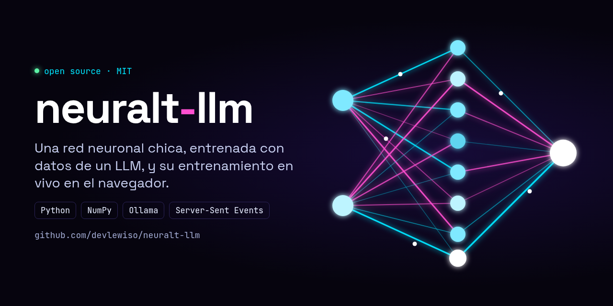
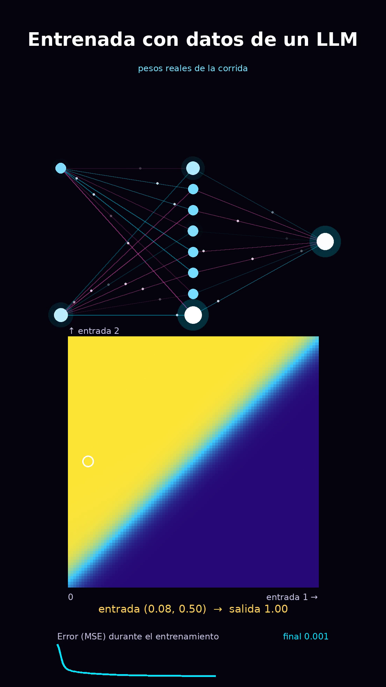
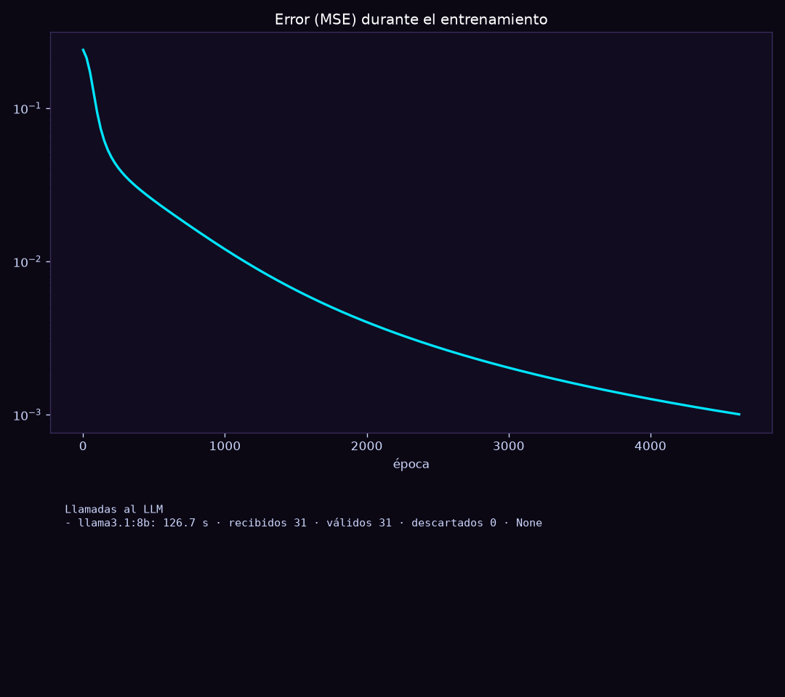
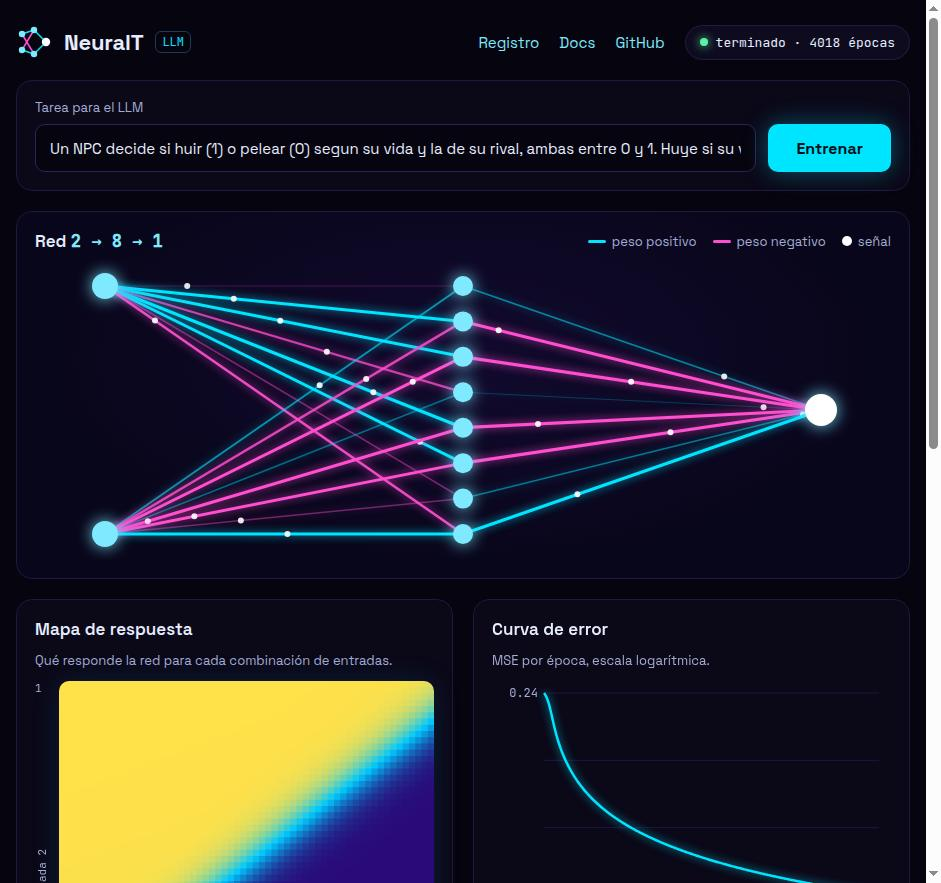

# neuralt-llm



Una red neuronal chica, entrenada con datos que genera un LLM, y un servidor local que muestra el entrenamiento en vivo.

Es un proyecto educativo: sirve para ver cómo aprende una red, paso a paso, y cómo se relaciona con un LLM. No es un modelo de producción.

## Qué se ve



- **Arriba:** la red con sus pesos reales. Las conexiones positivas son cian y las negativas magenta.
- **Medio:** el mapa de respuesta. Muestra qué sale para cualquier combinación de las dos entradas.
- **Abajo:** la curva del error (MSE) durante el entrenamiento.



El reporte sale de cada corrida: la curva de error y las llamadas al LLM (modelo, latencia, ejemplos recibidos, válidos y descartados).

## Requisitos

- Python 3.10 o más nuevo.
- `pip install -r requirements.txt` (numpy, matplotlib, Pillow).
- `ffmpeg`, solo si querés generar video con `render_red.py`.
- Un LLM para generar los datos. Dos opciones:
  - **Ollama** con un modelo local (por defecto `llama3.1:8b`). No necesita clave.
  - **API de Anthropic**, con la variable `ANTHROPIC_API_KEY`.

## Uso rápido

```bash
pip install -r requirements.txt

python main.py xor                          # prueba sin LLM: aprende XOR
python main.py llm "Un NPC decide si huir (1) o pelear (0) según su vida y la de su rival, ambas entre 0 y 1."
python main.py reporte saved/runs/<corrida>.jsonl
python main.py predecir saved/xor.json 1 0
```

El comando `llm` pide ejemplos al LLM, entrena la red, guarda `saved/llm.json` y deja el reporte al lado del registro de la corrida.

### Servidor en vivo

```bash
python serve.py                  # http://127.0.0.1:8765
```



Abrís la página, escribís la tarea y tocás **Entrenar**. La red se anima desde el primer momento, el contador muestra cuánto lleva esperando al LLM, y cuando llegan los ejemplos se dibujan los pesos, el mapa y la curva en vivo.

### Video de la red entrenada

```bash
python render_red.py saved/llm.json saved/runs/<corrida>.jsonl salida.mp4 8
```

Genera un video vertical de 8 segundos (1080×1920) con la red, el mapa y la curva reproducida desde el registro.

## Configuración

| Variable | Valor por defecto | Para qué |
|---|---|---|
| `NEURALT_BACKEND` | `ollama` | `ollama` o `anthropic` |
| `OLLAMA_URL` | `http://192.168.1.100:11434` | Dónde está Ollama |
| `NEURALT_MODELO` | `llama3.1:8b` (Ollama) o `claude-haiku-5-5` (Anthropic) | Modelo a usar |
| `ANTHROPIC_API_KEY` | — | Clave de la API de Anthropic. Va en tu terminal, nunca en el código |

Ejemplo con Ollama local:

```bash
OLLAMA_URL=http://127.0.0.1:11434 python main.py llm "tu tarea"
```

## Cómo funciona

1. **Datos:** `llm.py` le pide al LLM ejemplos de entrada → salida para la tarea que describas. Descarta los que vienen mal formados.
2. **Entrenamiento:** `nn.py` implementa una red MLP en numpy, con backpropagation y descenso de gradiente. La arquitectura por defecto es 2 → 8 → 1.
3. **Observabilidad:** `observe.py` guarda cada corrida en `saved/runs/*.jsonl` (inicio, tarea, llamadas al LLM, épocas, fin) y genera el reporte PNG.

## Estructura

- `nn.py`: la red (forward, backprop, guardar y cargar en JSON).
- `llm.py`: el puente con el LLM (Ollama o Anthropic).
- `observe.py`: registro de corridas y reporte visual.
- `main.py`: comandos de línea (`xor`, `llm`, `predecir`, `reporte`).
- `serve.py`: servidor en vivo con Server-Sent Events.
- `pagina.html`: la página del servidor en vivo (red, mapa, curva, métricas y registro).
- `render_red.py`: video vertical de la red entrenada.
- `docs/`: banner y capturas del README (`banner.html` es la fuente del banner).

## Limitaciones

- Solo tiene 2 entradas y una salida. Es suficiente para ver el proceso, pero no para problemas reales.
- Cada corrida empieza de cero. La red no acumula lo que aprendió en corridas anteriores.
- Los ejemplos que genera el LLM no se guardan en disco. Quedan solo el resumen y las métricas en el registro.
- Las etiquetas del LLM no se verifican. Si el LLM se equivoca, la red aprende el error.
- Con los datos actuales, la mayor parte del mapa de respuesta queda cerca de 0 o de 1.

## Licencia

Licencia [MIT](LICENSE). Es software libre: podés usarlo, modificarlo y redistribuirlo.
